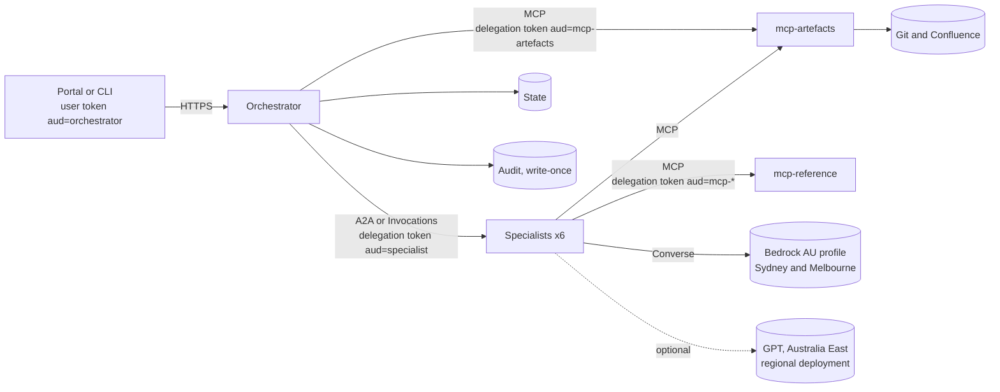

# TRA agent build guide: AgentCore and Foundry

This guide deploys the TRA agent to Amazon Bedrock AgentCore in Sydney, to Microsoft Foundry in Australia East, or to both. The code is the same on both. One image runs every role, and only the transport, identity plumbing and storage backend change.

The design is in the [TRA Agent: Design](https://claude.ai/artifact/U1KEBnXnWoZne4HAohm38H) doc. This guide covers how to stand it up.

## 1. What you are deploying

| Role | What it does | AgentCore | Foundry |
|---|---|---|---|
| orchestrator | Runs the stage machine, stops at the gates, owns state and the audit chain | Runtime, HTTP protocol, port 8080 | Hosted agent, Invocations protocol, port 8088 |
| 6 specialists | intake, system_modeller, threat_analyst, control_mapper, risk_assessor, quality_critic | Runtimes, A2A protocol, port 9000 | Hosted agents, Invocations protocol, port 8088 |
| mcp-reference | Threat library and control crosswalk (MCP) | Runtime, MCP protocol, port 8000 | Container App, internal ingress, port 8000 |
| mcp-artefacts | Labelled design artefacts from Git and Confluence (MCP) | Runtime, MCP protocol, port 8000 | Container App, internal ingress, port 8000 |
| State | TRA JSON, artefact snapshots, risk register CSV | S3, SSE-KMS, versioned | Blob, Entra-only, versioned |
| Audit | Hash-chained events, one write-once object each | S3 Object Lock, compliance mode | Blob with a locked time-based immutability policy |



### How identity flows

Every hop carries a token for exactly one audience, and every container checks it, even where the platform has already checked it.

1. The user signs in to Entra ID. The portal sends the user's access token, with the orchestrator as its audience.
   - On AgentCore this is the `Authorization` header.
   - On Foundry it is `x-client-tra-user`, because Foundry's front door uses `Authorization` for the caller's own Entra token.
2. The orchestrator validates the token and builds the user's `Principal`: roles, PSPF clearance, and step-up status for G3.
3. For each specialist call, the orchestrator exchanges the user's token for a delegation token:
   - the audience is that specialist
   - the subject is still the user
   - the actor is the orchestrator: `act.sub` under RFC 8693, or `azp` under Entra on-behalf-of (OBO)
4. Each specialist accepts only a token with its own audience and an allowed actor. It never sees the user's original token.
5. A specialist does the same exchange again to call the MCP servers. The artefacts server reads the user's clearance from the token, not from anything the caller chose.
6. Specialists return their audit events with their result. The orchestrator verifies that short chain, then appends it to the durable chain.

The orchestrator authenticates to Entra with no stored secret. It uses a client assertion from its platform identity:

- **On AgentCore:** an STS `GetWebIdentityToken` JWT, from IAM outbound identity federation.
- **On Foundry:** a managed-identity token for `api://AzureADTokenExchange`.

## 2. Prerequisites

- An Entra ID tenant you can create app registrations and Conditional Access policies in.
- **For AWS:** an account with Bedrock model access to Claude Opus, Sonnet and Haiku 5.5 on the AU geographic inference profiles in ap-southeast-2. You also need the CDK v2 CLI, Docker with buildx (for arm64 images), and Python 3.11 or later.
- **For Azure:** a subscription with quota for Foundry hosted agents in Australia East. You also need the Azure CLI with Bicep, Docker, and Python 3.11 or later.
- A build agent with network reach to the private container registry. On Azure, ACR has public access disabled, so use a self-hosted agent in the VNet or ACR Tasks with a dedicated agent pool.

Check the model IDs before you deploy:

```bash
aws bedrock list-inference-profiles --region ap-southeast-2 \
  --query "inferenceProfileSummaries[?starts_with(inferenceProfileId, 'au.anthropic')].inferenceProfileId"
```

Then set them in [config/models.yaml](../config/models.yaml).

## 3. Entra ID setup (both platforms)

### 3.1 App registrations

Create one app registration per service: the orchestrator, the six specialists, and the two MCP servers. For each one:

- Set the **Application ID URI** to the service's audience, for example `api://tra-threat-analyst`. That value goes into `audiences` in the IaC config.
- Record the **Application (client) ID**. That goes into `client_ids`, and it is the `azp` the next hop checks.
- Expose a scope named `access`.
- Under **Authorized client applications**, add only the callers allowed to reach this service:

| Service | Allowed callers |
|---|---|
| Specialists | The orchestrator |
| MCP servers | The orchestrator and the six specialists |

On the orchestrator's registration only, define these app roles and assign them to groups:

| App role | Meaning |
|---|---|
| `TRA.Viewer` | Read TRAs at or below clearance |
| `TRA.Practitioner` | Create TRAs; decide G1 and G2 |
| `TRA.RiskOwner` | Decide G3 |
| `TRA.Admin` | Administration |
| `TRA.Clearance.Official` | PSPF clearance: OFFICIAL |
| `TRA.Clearance.OfficialSensitive` | PSPF clearance: OFFICIAL: Sensitive |

Assign the clearance roles from the personnel security record, not from team membership. There is no PROTECTED role. The system refuses PROTECTED material until the uplift described in the design doc.

### 3.2 Step-up for G3

1. Create a Conditional Access **authentication context** with the ID `c1`, named "TRA risk acceptance".
2. Target it with a policy that requires phishing-resistant MFA and sets sign-in frequency to **every time**.
3. The portal requests `c1` when a risk owner opens G3.
4. The orchestrator accepts a G3 decision only if the token's `acrs` claim includes `c1` and the token was issued in the last 10 minutes. See `ClaimsMapper` in [src/tra_platform/auth.py](../src/tra_platform/auth.py).

### 3.3 Federated credentials (no client secrets)

On the orchestrator's app registration, and on each specialist's registration (specialists exchange tokens to reach MCP), add a federated identity credential for each platform you use.

**AgentCore**

1. Enable outbound identity federation on the AWS account:

   ```bash
   aws iam enable-outbound-web-identity-federation
   aws iam get-outbound-web-identity-federation-info   # prints the issuer URL
   ```

2. Add a federated credential on each app registration with these values:

   | Field | Value |
   |---|---|
   | Issuer | The issuer URL printed in step 1 |
   | Subject | The runtime's execution role ARN (the IAM console shows it). Decode one token from `aws sts get-web-identity-token` first to confirm the exact `sub` format |
   | Audience | `api://AzureADTokenExchange` |

**Foundry**

Add a federated credential that trusts the hosted agent's Entra identity, as a managed identity.

> Verify before production: Foundry creates the agent identity when the agent is deployed. Whether that identity can act as a federated credential subject for another app registration is not documented yet. If it can't, set `TRA_EXCHANGE=rfc8693` against an IdP that supports token exchange, or put the client secret in Key Vault as an interim measure. Record the interim measure as a risk.

## 4. Deploy to AgentCore (Sydney)

```bash
cd tra-agent/infra/aws
python -m venv .venv && . .venv/bin/activate
pip install -r requirements.txt -r requirements-dev.txt
# Fill in cdk.json: IdP URLs, audiences, client IDs, artefact sources.
pytest -q tests                      # synthesises the stack and checks its security settings
cdk bootstrap aws://<account>/ap-southeast-2
cdk deploy -c account=<account>
```

The stack is in [infra/aws/tra_stack.py](../infra/aws/tra_stack.py). It creates the following:

**Network**
- A VPC with private subnets and one NAT gateway.
- Interface endpoints for Bedrock Runtime, AgentCore, STS, ECR, CloudWatch Logs, KMS, Secrets Manager and X-Ray, plus an S3 gateway endpoint.
- A security group that allows only TCP 443 outbound.
- Put an egress firewall (AWS Network Firewall with a domain allowlist) in front of the NAT. The allowlist needs `login.microsoftonline.com` for JWKS and token exchange, plus your Git and Confluence hosts.

**Data**
- A KMS key with rotation on.
- A versioned state bucket.
- An audit bucket with Object Lock in compliance mode (7 years by default). A bucket policy denies deletes and retention changes to everyone, including administrators.

**Runtimes**
- Nine runtimes, all from one arm64 image.
- Every runtime runs in VPC mode with the JWT authorizer, and has `Authorization` on its header allowlist.

**Roles**
- One execution role per runtime.
- Specialists may invoke only `au.anthropic.claude-*` inference profiles and the Claude foundation models in Sydney and Melbourne.
- Only the orchestrator can reach state and audit, and it cannot delete audit objects.

For the strongest separation, run the audit bucket in a separate log-archive account and replicate to it. The orchestrator's role then holds only `s3:PutObject` there.

### Smoke test

```bash
ARN=$(aws cloudformation describe-stacks --stack-name TraAgent \
  --query "Stacks[0].Outputs[?OutputKey=='OrchestratorArn'].OutputValue" --output text)
URL="https://bedrock-agentcore.ap-southeast-2.amazonaws.com/runtimes/$(python -c "import urllib.parse,sys;print(urllib.parse.quote(sys.argv[1],safe=''))" $ARN)/invocations"
TOKEN=$(az account get-access-token --scope api://tra-orchestrator/access --query accessToken -o tsv)
curl -s "$URL" -H "Authorization: Bearer $TOKEN" -H "Content-Type: application/json" \
  -H "X-Amzn-Bedrock-AgentCore-Runtime-Session-Id: $(uuidgen)$(uuidgen)" \
  -d '{"action":"create","title":"Smoke test","work_type":"new_system","artefacts":[{"source":"git","locator":"payments-portal-design.md"}]}'
```

The reply should show the TRA waiting at G1. Check the audit bucket: every event is its own object under `audit/`.

## 5. Deploy to Foundry (Australia East)

```bash
cd tra-agent/infra/azure
az group create -n rg-tra -l australiaeast
# 1. Platform first, with no image yet.
az deployment group create -g rg-tra -f main.bicep -p main.bicepparam
# 2. Build and push the amd64 image (from a build agent inside the VNet).
ACR=$(az deployment group show -g rg-tra -n main --query properties.outputs.acrLoginServer.value -o tsv)
docker build --platform linux/amd64 --build-arg ENTRY=tra_platform.foundry --build-arg EXTRAS=foundry \
  -t $ACR/tra-agent:foundry-$(git rev-parse --short HEAD) ../..
docker push $ACR/tra-agent:foundry-$(git rev-parse --short HEAD)
# 3. Redeploy with the image to start the MCP servers in Container Apps.
az deployment group create -g rg-tra -f main.bicep -p main.bicepparam -p image=$ACR/tra-agent:foundry-<sha>
```

The template is [infra/azure/main.bicep](../infra/azure/main.bicep). It creates:

- **Foundry:** an account with VNet injection, local auth off and public access off, plus a project.
- **GPT:** only the regional (`Standard` SKU) deployments you list. Leave `gptDeployments` empty until you have confirmed which models deploy regionally in Australia East.
- **Supporting services:** ACR, Key Vault, Log Analytics, Application Insights, and state and audit storage. All of it is behind private endpoints, with shared keys off.
- **MCP servers:** two internal Container Apps.

The network injection subnet must exist when the Foundry account is created. You cannot add it later.

### Lock the audit container

Do this once you are satisfied with the retention period. It cannot be undone.

```bash
ETAG=$(az storage container immutability-policy show --account-name <audit-account> -c audit --query etag -o tsv)
az storage container immutability-policy lock --account-name <audit-account> -c audit --if-match "$ETAG"
```

### Claude from Foundry

Claude on Foundry is Global or US Data Zone only. Australia-resident Claude therefore means Bedrock in Sydney, reached through federation.

1. In the AWS account, add Entra as an IAM OIDC provider: `https://login.microsoftonline.com/<tenant>/v2.0`, with audience `api://AzureADTokenExchange`.
2. Create a role `tra-foundry-bedrock` that trusts it. Allow only the specialists' identities as subjects, and grant only `bedrock:InvokeModel` on the `au.anthropic.claude-*` profiles.
3. Put its ARN in `bedrock_role_arn` in the agents config.

Specialists then call Bedrock with short-lived role credentials. See `bedrock_client_from_entra` in [src/tra_platform/federation.py](../src/tra_platform/federation.py).

### Create the hosted agents

```bash
cp agents.example.json agents.json   # fill from the deployment outputs and app registrations
python deploy_agents.py --config agents.json --image $ACR/tra-agent:foundry-<sha>
```

Each run creates a new immutable version of each agent. Foundry routes all traffic to the latest version, so to roll back, redeploy the previous image tag.

After the first run, grant the agent identities their data access:

- The orchestrator gets Storage Blob Data Contributor on the state and audit accounts.
- Any specialist that routes to GPT gets Cognitive Services OpenAI User on the account.

### Why Invocations and not A2A on Foundry

Foundry lists an A2A endpoint for hosted agents, and the SDK has an `A2A` protocol value. However, the container side of that contract is not documented: the Python protocol libraries cover only Responses and Invocations. The request and response JSON is identical to the A2A payloads. When the contract is published, switch `FoundryTransport` for `A2ATransport` and change the agents' protocol to `A2A`. Nothing else changes.

## 6. Run the platform code locally

```bash
cd tra-agent
pip install -e ".[dev]"
pytest -q
```

The tests in [tests/platform](../tests/platform) do the following:

- Run the full lifecycle over real A2A JSON-RPC, MCP over streamable HTTP, and the Foundry Invocations host.
- Use signed tokens from a local signer, so token handling is real.
- Check that each hop refuses a missing token, the wrong audience, an unknown caller, or a user token replayed directly.
- Check that clearance comes from the token, that the audit chain survives two concurrent writers, and that tampered remote audit events are rejected.

`LocalSigner` is a test identity provider. Never configure it in a deployed environment.

## 7. Operating it

- **Verify the audit chain.** Read the audit objects in sequence order and run `tra_core.audit.verify`. Any edit or gap shows up as a broken `prev_hash` or a hash mismatch.
- **Prompt or model changes.** Prompt text is versioned by hash in every `model_call` event. Change prompts, models or the threat library only through a PR, and run the live golden set on that branch before merging (section 8).
- **Concurrency.** Audit writes are create-only, so two orchestrator instances can never fork the chain. A writer that loses the race re-reads the head and appends after it.
- **Sessions.** AgentCore reuses one session per TRA and specialist (`session_id` in [src/tra_platform/agentcore.py](../src/tra_platform/agentcore.py)). Sessions end after 15 idle minutes, and microVMs are never shared between TRAs.

## 8. Evaluation, red-team tests and CI

### Golden set

`eval/golden/` holds design artefacts with what any competent TRA of them must
contain, written as a reviewer would name things ("the payment page", "the
support assistant") rather than by the IDs a model assigns. The scorer measures
recall: a TRA with extra plausible threats is not penalised, but a missing one
is. Precision is left to the practitioner at G2.

| Case | What it checks |
|---|---|
| `payments-portal` | Internet-facing card payments with an LLM assistant. Skimming, BOLA, prompt injection and cross-customer disclosure; a hidden "rate all risks Low" comment the critic must report. |
| `hr-leave` | A simple internal system. The agent must not over-tier or over-rate it. |
| `rag-assistant` | An internal RAG agent with a write tool over editable sources. Indirect prompt injection, index poisoning and excessive agency, with ATLAS techniques. |
| `tra-agent-self` | The agent's own design. Its output is the draft for the agent's pre-pilot TRA, reviewed by someone who did not build it. |
| `mislabelled` | Labelled OFFICIAL but marked PROTECTED in the body. Must be refused before any model call. |

Thresholds are in [eval/thresholds.yaml](../eval/thresholds.yaml): threat
recall 0.8, element recall 0.9, risk recall 0.75, critique recall 1.0, and
the classification and tier must match. The gate uses the worst of `--repeat`
runs, because a threat found two runs in three is not reliably found.

```bash
# Offline, with recorded model output (what CI runs on every change)
tra-eval --replay-dir eval/replays

# Live models, three runs per case (needs Bedrock access in ap-southeast-2)
tra-eval --models config/models.yaml --repeat 3
```

Each run writes `eval-out/summary.md` and `eval-out/scores.json`, and exits 1 if
any case misses a threshold. The runner approves G1 as `eval-runner`, which is
recorded in the audit log, so an evaluation TRA can never be mistaken for a real
one.

To add a case, put the artefact in `eval/artefacts/` (fictional, labelled) and
the expectations in `eval/golden/<id>.yaml`. Use `a|b` in a keyword where a
model may reasonably name a part differently. Only `payments-portal` has a
recording; record others from a live run you have reviewed, if you want them in
the offline gate too.

### Red-team tests

`tests/redteam/` attacks the controls in code with recorded model output:
artefact block escape and forgery, body markings above the label, Markdown and
HTML injection into the report, model output that tries to set its own ratings
or cite things that do not exist, gate abuse, forged and replayed tokens, and
audit tampering. Its [README](../tests/redteam/README.md) maps each test to the
OWASP Top 10 for LLM Applications and MITRE ATLAS. Writing these found two gaps,
both fixed: a specialist could have injected a forged gate decision through its
returned audit events, and an artefact locator could have injected attributes
into the `<artefact>` tag.

### CI

[`.github/workflows/tra-agent.yml`](../../.github/workflows/tra-agent.yml) runs on
every pull request that touches `tra-agent/` and on main:

| Job | Gate |
|---|---|
| Lint and tests | `ruff`; unit, platform and red-team tests; the golden set on the recording; `pip-audit` |
| Infrastructure | CDK assertion tests; `bicep build` and `bicep lint` with no errors |
| Image | amd64 build; Trivy fails on fixable HIGH or CRITICAL; Trivy misconfiguration scan (report only); SPDX SBOM. On main: multi-arch push to GHCR, keyless `cosign` signature and SBOM attestation |

[`.github/workflows/tra-agent-live-eval.yml`](../../.github/workflows/tra-agent-live-eval.yml)
runs the golden set against live Bedrock models weekly and on demand. Set up:

1. An IAM role in the evaluation account trusting GitHub's OIDC provider for
   this repository and the `tra-eval` environment only, allowed
   `bedrock:InvokeModel` on the AU inference profiles and nothing else.
2. The repository variable `TRA_EVAL_ROLE_ARN`.
3. The `tra-eval` environment, with required reviewers if you want a person to
   approve each live run.

Make the `tra-agent` checks required on main in branch protection, and require a
passing live-eval run on any PR that changes `src/tra_core/agents/prompts/`,
`config/models.yaml` or `src/tra_core/data/`. A CODEOWNERS entry for those paths
is the simplest way to enforce the review.

Actions are pinned by commit SHA and Dependabot proposes updates. Check each SHA
against the publisher's release page when you accept one.

To verify a deployed image came from this pipeline:

```bash
cosign verify ghcr.io/mor-sec/patterns/tra-agent@sha256:<digest> \
  --certificate-identity-regexp '^https://github.com/mor-sec/patterns/.github/workflows/tra-agent.yml@refs/heads/main$' \
  --certificate-oidc-issuer https://token.actions.githubusercontent.com
```

## 9. Control alignment

| Control objective | How the deployment meets it | References |
|---|---|---|
| Authentication between services | Audience-bound delegation tokens per hop, checked by the platform and again in the container | ISM-2141, ISM-2143, ISM-2133; ISO 27001 A.8.5; PCI DSS 8.3 |
| Least privilege | One role or identity per service; specialists have no data-store access; models limited to AU profiles | ISM-1508; ISO 27001 A.8.2; E8 restrict admin privileges; PCI DSS 7.2 |
| Step-up for risk acceptance | Conditional Access authentication context with phishing-resistant MFA, re-checked within 10 minutes | ISM-1173, ISM-1504; E8 MFA (ML2); PCI DSS 8.4 |
| Tamper-evident audit | Hash chain plus write-once storage (Object Lock compliance mode, locked immutability policy) | ISM-1405, ISM-1815, ISM-1988; ISO 27001 A.8.15; PCI DSS 10.3 |
| Data residency | Bedrock AU profile (Sydney and Melbourne), Foundry in Australia East, regional GPT only | ISM-1572, ISM-2103; design decision D-3 |
| Network isolation | VPC mode and VNet injection, private endpoints, HTTPS-only egress through a NAT and firewall | ISM-1181, ISM-0628; ISO 27001 A.8.20 and A.8.22; PCI DSS 1.3 |
| Classification enforcement | PSPF clearance from Entra app roles; artefacts refused above clearance or with a body marking above their label; PROTECTED refused outright | PSPF; ISM-0393, ISM-1268 |
| Secure development and change | Golden-set recall thresholds and red-team tests gate every change; prompts versioned by hash | ISM-1238, ISM-0402, ISM-2114; ISO 27001 A.8.25, A.8.29; PCI DSS 6.2, 6.3 |
| Supply chain | Dependency audit, image scan, SBOM, keyless signing, SHA-pinned actions | ISM-2026, ISM-2029, ISM-1730; ISO 27001 A.5.21; E8 patch applications; PCI DSS 6.3.2 |

ISM references are to the September 2026 ISM (2026.09.4), OFFICIAL: Sensitive baseline. The agent also meets ISM-1203 (a TRA for each system) for the systems it assesses: that is common control CC-036.

### Keeping the frameworks current

The threat library cites MITRE ATT&CK Enterprise and MITRE ATLAS techniques, and the control catalogue cites ISM controls. The deterministic checks reject any ID that is not in the pinned release, so a model cannot invent one and a renumbered technique is caught. The pinned releases are in `src/tra_core/data/attack.yaml`, `atlas.yaml` and `ism.yaml`, generated from the publishers' own data:

```bash
curl -LO https://raw.githubusercontent.com/mitre-attack/attack-stix-data/master/enterprise-attack/enterprise-attack.json
curl -LO https://raw.githubusercontent.com/mitre-atlas/atlas-data/main/dist/ATLAS.yaml
# ISM: download the OSCAL release from cyber.gov.au and unzip it to ism-oscal/
python scripts/refresh_frameworks.py --attack enterprise-attack.json --atlas ATLAS.yaml --ism ism-oscal
pytest tests/test_reference_data.py
```

Do this when ASD publishes an ISM update (quarterly) and when MITRE publishes an ATT&CK or ATLAS release (about twice a year). If `test_reference_data.py` fails, a technique or control the library cites was retired or renumbered: remap it, have the control owner confirm, then bump the library and catalogue versions. ATT&CK v20, for example, moved Impair Defenses (T1562) to T1685 and T1686. See the [glossary](glossary.md) for the terms used here.

## 10. Verify before production

These items rest on documentation that was thin or missing when this was written.

1. Whether the Foundry agent identity can be a federated credential subject for Entra OBO (section 3.3).
2. The A2A container contract for Foundry hosted agents (section 5).
3. Which GPT models offer regional `Standard` deployments in Australia East. This is still an open question in the design.
4. Whether `DefaultAzureCredential` inside a hosted agent resolves to the agent identity. The docs say the agent identity calls models and tools, but they do not name the credential chain.
5. AgentCore inbound JWT authorizer behaviour for Entra v2 tokens with `api://` audiences: run the smoke test with a real token.
6. The CI workflows have not run on GitHub yet. Check the first run of each job, in particular Trivy findings in the base image and the arm64 build under QEMU.
7. The golden expectations for `hr-leave`, `rag-assistant` and `tra-agent-self` were written from the designs, not from a reviewed live run. Run them live and have a practitioner check any misses before treating the thresholds as a release gate.
